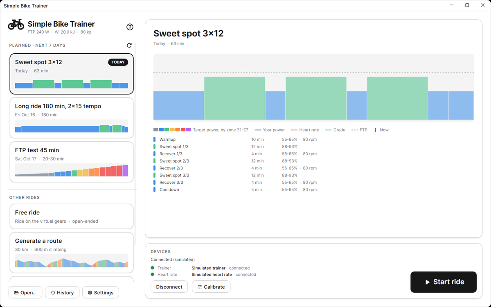
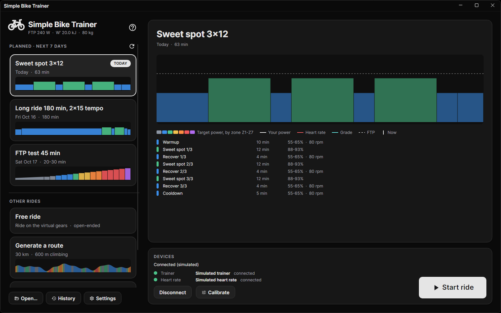
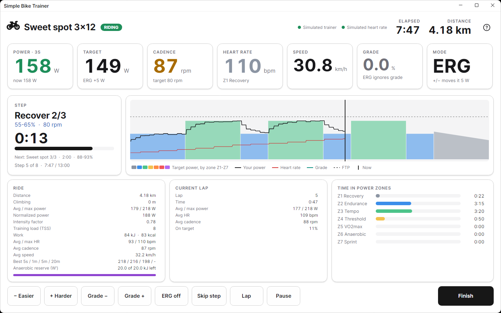
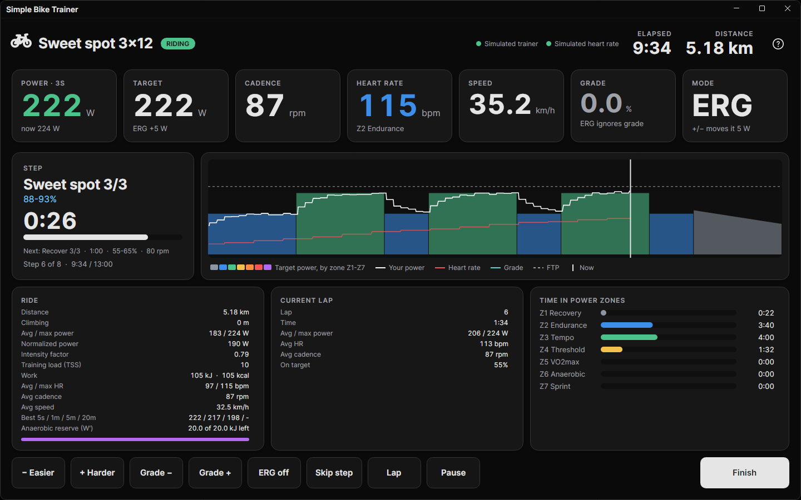
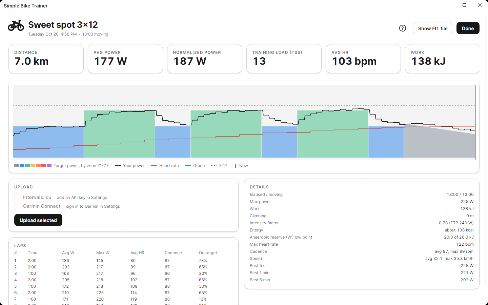
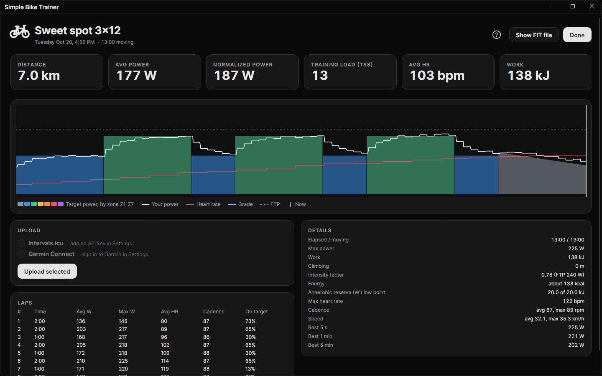
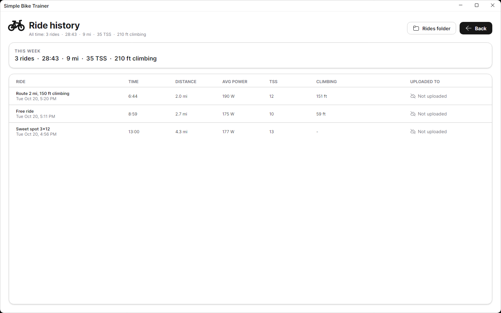
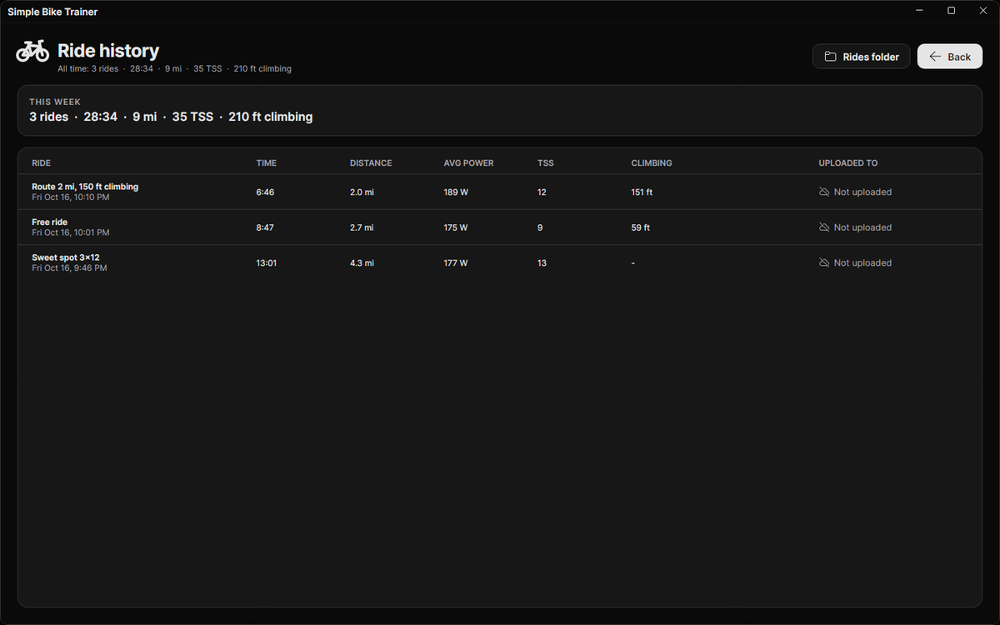
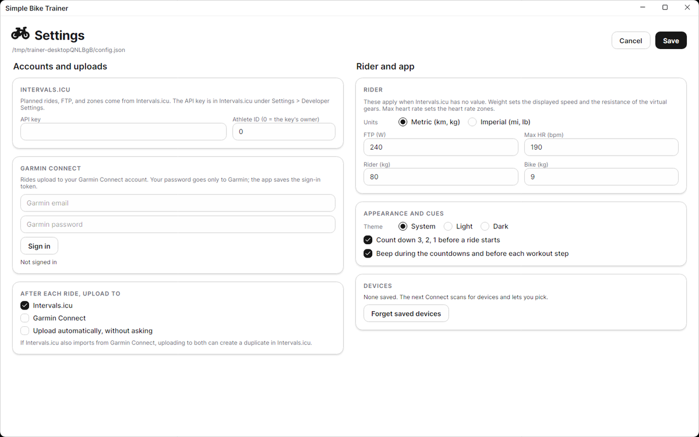
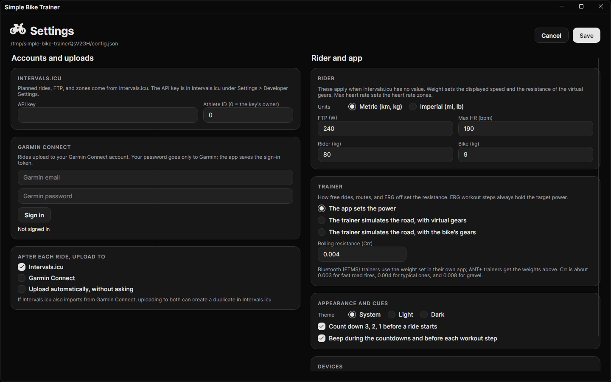

# Simple Bike Trainer

Simple Bike Trainer rides Intervals.icu workouts on a Wahoo KICKR or any other Bluetooth FTMS or ANT+ FE-C trainer, shifts virtual gears with a Zwift Click, records each ride as a FIT file, and uploads it to Intervals.icu and Garmin Connect. It also generates rolling routes with a set length and amount of climbing. `simple-bike-trainer` is the desktop app; `simple-bike-trainer-cli` is the terminal version, with Bluetooth and ANT+ diagnostics.

| | Light | Dark |
| --- | --- | --- |
| Home |  |  |
| Ride |  |  |
| Summary |  |  |
| History |  |  |
| Settings |  |  |

## Install

See [Releases](https://github.com/crobibero/Simple-Bike-Trainer/releases/)

## Setup

Get an Intervals.icu API key under Settings > Developer Settings in Intervals.icu, then enter it in the app's Settings.

| What | Where | On Windows |
| --- | --- | --- |
| Settings | `~/.config/simple-bike-trainer/config.json`, mode 0600. `INTERVALS_API_KEY` and `INTERVALS_ATHLETE_ID` override the saved values. | `%APPDATA%\simple-bike-trainer\config.json` |
| Garmin session tokens | `~/.config/simple-bike-trainer/garmin/garmin_tokens.json`, mode 0600 | `%APPDATA%\simple-bike-trainer\garmin\garmin_tokens.json` |
| Rides | `~/.local/share/simple-bike-trainer/rides/` | `%LOCALAPPDATA%\simple-bike-trainer\rides\` |

## Devices

Connect scans Bluetooth, the local network for Wi-Fi trainers and, when an ANT+ USB stick is plugged in, ANT+ at the same time. Any one is enough.

| Device | Bluetooth | ANT+ |
| --- | --- | --- |
| Trainer | FTMS (KICKR and most smart trainers): ERG, road simulation, spin-down | FE-C: ERG, road simulation |
| Heart rate | Heart Rate Service, including watches that broadcast it | Heart rate straps and watches that broadcast it |
| Zwift Click, Play, Ride | Yes | No such devices |

| System | Bluetooth |
| --- | --- |
| Linux | BlueZ. `devices.adapter` in `config.json` picks an adapter, such as `hci1`. |
| Windows 10 2004 or later | Built in |
| macOS 12 or later | Built in |
| Android 12 or later | Built in |
| iPadOS 15 or later | Built in |

### ANT+

ANT+ works with Garmin and Dynastream ANTUSB2 and ANTUSB-m sticks, through [libusb](https://libusb.info). The app finds the stick at each scan and keeps going without it.

| System | Setup |
| --- | --- |
| Linux | libusb comes with most distributions. Give your user the stick with `/etc/udev/rules.d/70-ant-stick.rules` holding `SUBSYSTEM=="usb", ATTR{idVendor}=="0fcf", ATTR{idProduct}=="100[89]", TAG+="uaccess"`, run `sudo udevadm control --reload`, and plug the stick in again. |
| macOS | `brew install libusb` |
| Windows | Put `libusb-1.0.dll` (64-bit, from the libusb releases) next to `simple-bike-trainer.exe`, and give the stick the WinUSB driver with [Zadig](https://zadig.akeo.ie). Other ANT+ apps on the PC may then not see the stick. |
| Android | Plug the stick into the tablet's USB-C port through an OTG adapter. No libusb, and no ANT Radio Service or ANT USB Service app: Android asks once whether the app may use the stick, either when it is plugged in or at the first scan. If the ANT USB Service is installed, tell Android not to open it for the stick. |
| iPad | Not supported: iPadOS gives apps no access to USB devices. |

A stick that is plugged in but will not open, for lack of permission or because another app has it, shows a warning when scanning. `simple-bike-trainer-cli scan` lists the ANT+ devices with the Bluetooth ones.

### Wi-Fi

Wahoo trainers with Wi-Fi, or with the KICKR Direct Connect Ethernet adapter, also connect over the network using Wahoo Direct Connect. The trainer offers the same FTMS service it offers over Bluetooth, so ERG, road simulation and spin-down work the same way. The scan finds these trainers by mDNS (`_wahoo-fitness-tnp._tcp`) and lists them with a `Wi-Fi` address next to their Bluetooth entry. Pick the Wi-Fi entry to ride over the network. Heart rate monitors and Zwift controllers still connect over Bluetooth or ANT+.

When mDNS does not reach the trainer, for example across VLANs or on a guest network, give the trainer's address with `simple-bike-trainer-cli config --wifi-trainers 192.168.1.40` (the port defaults to 36866). `simple-bike-trainer-cli probe --wifi 192.168.1.40` connects to that address without scanning. On macOS the app asks for Local Network access the first time it scans.

The iPad app does not find Wi-Fi trainers: iPadOS blocks mDNS queries from apps without a multicast entitlement from Apple. Ride a Wi-Fi trainer over Bluetooth instead.

## Riding

The home page lists the next 7 days of planned rides from Intervals.icu, plus a free ride, a generated route, and a ramp FTP test. The first Connect scans for devices and lets you pick a trainer, heart rate monitor, and Zwift controllers; later connects reuse the choice. The `?` button or F1 explains every number on the ride page.

| Input | ERG step | Free ride or ERG off |
| --- | --- | --- |
| Click `+` (or `Y`), `+` or `↑` | target +5 W | shift up a gear |
| Click `-` (or `B`), `-` or `↓` | target −5 W | shift down a gear |
| `←` / `→` | | grade −/+ 0.5% |
| `e` | switch to gears | switch back to ERG |
| `s`, `l`, `p` or space | skip step, lap, pause | |
| `x` | end the ramp test | |
| `q` twice | finish the ride | |

### Resistance off ERG

Settings > Trainer picks how free rides, routes and ERG off set the resistance. ERG steps always hold their power.

| Choice | How it works | For |
| --- | --- | --- |
| The app sets the power (default) | Once a second, the app works out the power the virtual gear, cadence and grade cost, and holds the trainer at it. | Any trainer |
| The trainer simulates the road, with virtual gears | The app sends the grade, rolling resistance, wind resistance and weights, and the trainer sets the resistance from its flywheel speed, so sprints feel like the road. A virtual gear k times the real one scales grade and rolling resistance by k and wind by k³; what FTMS and FE-C cannot carry goes into the grade. Set the chainring and cog the chain is on. | A single-speed setup such as the Zwift Cog |
| The trainer simulates the road, with the bike's gears | The app sends the road as it is; shift on the bike. The Click and arrow keys do not shift. | A bike with a cassette |

FE-C trainers get the rider and bike weights; FTMS has no weight in its simulation command, so Bluetooth trainers use the weight set in their own app. Rolling resistance (Crr) is a setting too: about 0.003 for fast road tires, 0.004 for typical ones, and 0.008 for gravel. A trainer that cannot simulate falls back to the app setting the power, and the ride page says so.

The ride timer starts on the first pedal stroke and pauses after 3 seconds without power or cadence. Every 5 minutes the app saves a checkpoint; after a crash, the home page offers to save the unfinished ride.

## Uploads

| Destination | Setup |
| --- | --- |
| Intervals.icu | API key. Uploads link the ride to its planned workout. |
| Garmin Connect | Email, password, and MFA code in Settings, or `simple-bike-trainer-cli connect garmin`. Garmin forwards the ride to Strava and other linked apps. |

## Terminal app

The examples write `simple-bike-trainer-cli` for `dotnet run --project src/SimpleBikeTrainer.Cli --`.

```sh
simple-bike-trainer-cli --help
simple-bike-trainer-cli ride --event 91234567           # a planned ride
simple-bike-trainer-cli ride --route 30 --climb 400     # a 30 km loop with 400 m of climbing
simple-bike-trainer-cli ride --simulate --offline --file workout.txt
simple-bike-trainer-cli scan                            # list and save devices
simple-bike-trainer-cli probe                           # print trainer data and Click presses
```

## Development

Install the .NET 10 SDK.

```sh
dotnet run --project src/SimpleBikeTrainer.Desktop
dotnet test --solution SimpleBikeTrainer.slnx
dotnet tool restore && DOTNET_ROLL_FORWARD=Major dotnet xstyler --recursive --directory . --passive
```

`dotnet run --project src/SimpleBikeTrainer.Desktop -- --test` (or `SimpleBikeTrainer.exe --test`) adds a Simulate checkbox to the Home page, for riding a pretend trainer and heart rate monitor without hardware.

The last command checks XAML formatting with [XamlStyler](https://github.com/Xavalon/XamlStyler); without `--passive` it rewrites the files. [tests/SimpleBikeTrainer.Desktop.Tests](tests/SimpleBikeTrainer.Desktop.Tests) drives every page headlessly with simulated devices and saves screenshots to `$SIMPLE_BIKE_TRAINER_SCREENSHOTS`; the images above come from it.

On Windows, every project builds for `net10.0-windows10.0.19041.0`, for the WinRT Bluetooth API; elsewhere they build for `net10.0`. `dotnet build -p:WindowsBuild=true` checks the Windows build on Linux or macOS.

Releases use native AOT on every platform, which compiles only on the system it targets:

```sh
dotnet publish src/SimpleBikeTrainer.Desktop -c Release -r linux-x64 -p:PublishAot=true -o publish
```

Windows needs the Visual Studio C++ build tools; Linux needs clang, lld and the fontconfig headers (`libfontconfig-dev`). On Windows and Linux, [StaticLink.Avalonia](https://github.com/greepar/StaticLink.Avalonia) links Skia and HarfBuzz, and on Windows the ANGLE renderer, into the app, so the publish is one file. Each of its versions is built for one SkiaSharp version, which has to be the one Avalonia uses: an Avalonia update that moves SkiaSharp waits for a matching StaticLink.Avalonia. macOS keeps those libraries in the `.app` bundle.

The Android app is a second target framework of the desktop project, `net10.0-android`, added by `-p:AndroidBuild=true`. It needs `dotnet workload install android`, the Android SDK, and a JDK. With a tablet connected over adb:

```sh
dotnet build src/SimpleBikeTrainer.Desktop -t:Install -f net10.0-android -p:AndroidBuild=true
dotnet publish src/SimpleBikeTrainer.Desktop -c Release -f net10.0-android -r android-arm64 -p:AndroidBuild=true -o publish/android
```

The Debug build runs on the Mono runtime. The Release build uses native AOT, which needs the Android NDK r28 (`sdkmanager "ndk;28.2.13676358"`); r29 fails to link. `-p:AndroidNdkDirectory=...` picks the NDK when several are installed, `-p:AndroidSdkDirectory=...` points at the SDK when it is not found, and `-p:AdbTarget="-s SERIAL"` picks one of several devices. Android's Bluetooth, USB, screen lock, sounds and sharing are in [Platforms/Android](src/SimpleBikeTrainer.Desktop/Platforms/Android). CI signs the APK with the keystore in the `ANDROID_KEYSTORE` secret (base64), with `ANDROID_KEYSTORE_PASSWORD` and the key alias in `ANDROID_KEY_ALIAS`; without them it uses a throwaway debug key, and Android will not install such an APK over one signed with another key.

The iPad app is a third target framework, `net10.0-ios`, added by `-p:IosBuild=true`. It builds only on a Mac, with Xcode and `dotnet workload install ios`. To run it in the simulator:

```sh
dotnet build src/SimpleBikeTrainer.Desktop -t:Run -f net10.0-ios -p:IosBuild=true
```

An iPad needs a build signed with a provisioning profile for the app's bundle identifier, from an Apple developer account; a free account's profile lasts 7 days. With the profile installed and the iPad connected, this publishes a native AOT build and installs it:

```sh
dotnet publish src/SimpleBikeTrainer.Desktop -c Release -f net10.0-ios -r ios-arm64 -p:IosBuild=true \
  -p:ApplicationId=YOUR.BUNDLE.ID -o publish/ios
xcrun devicectl device install app --device IPAD-UDID publish/ios/*.ipa
```

`dotnet build` runs the iPad app on Mono instead, for the debugger: `dotnet build src/SimpleBikeTrainer.Desktop -t:Run -c Release -f net10.0-ios -p:IosBuild=true -p:RuntimeIdentifier=ios-arm64 -p:ApplicationId=YOUR.BUNDLE.ID -p:_DeviceName=IPAD-UDID` installs that build.

| Project | Contents |
| --- | --- |
| [src/SimpleBikeTrainer.Core](src/SimpleBikeTrainer.Core) | Bluetooth (BlueZ, WinRT, CoreBluetooth) and ANT+ devices, workouts, the ride loop, metrics, FIT recording, and the Intervals.icu and Garmin clients |
| [src/SimpleBikeTrainer.Desktop](src/SimpleBikeTrainer.Desktop) | The Avalonia app, for the desktop, Android and iPad |
| [src/SimpleBikeTrainer.Cli](src/SimpleBikeTrainer.Cli) | The terminal app and the `scan` and `probe` diagnostics |


## License

[GPL-3.0-only](LICENSE). [THIRD-PARTY-NOTICES.md](THIRD-PARTY-NOTICES.md) lists the projects parts of this code are based on.
